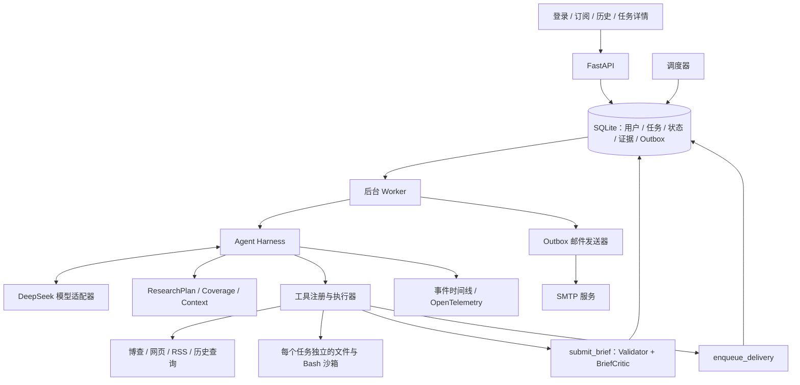

# 每日 AI 新闻助手：实施计划 v1.1

更新日期：2026-10-09。用途：作为后续开发对话的独立行动指南。本文确定实施方案，尚未实现业务代码；v1.0 保留为历史规划。项目重点是后端 Agent 的决策、执行、验证和恢复，页面用于操作与展示这些能力。

## 1. 交付目标与技术选型

- Python + FastAPI + 原生 HTML/CSS/JavaScript；手写 Function Calling 循环与 Agent harness。
- DeepSeek 提供模型能力，博查提供联网搜索，SMTP 提供邮箱推送；模型和搜索供应商分别通过适配器接入。
- 简单注册、登录；设置身份、邮箱、话题、关注关键词、排除关键词、订阅开关和每日推送时间。每人先支持一份订阅。
- 默认每天北京时间 09:00，覆盖此前 24 小时，检索中英文来源，统一输出中文，最多 5 条。时间可修改，条数可在 1～5 内设置。
- 支持立即生成预览、查看历史简报、查看任务计划与执行时间线。预览与定时生成共用 Agent，预览只生成内容；定时任务完成邮件入队。
- Docker Compose 本地演示，复用镜像部署到单台 Linux 服务器；MVP 使用 SQLite、单个后台 Worker，数据访问采用 SQLAlchemy，迁移采用 Alembic。
- 所有凭据和运行参数集中放在 `.env`，由独立配置模块读取；修改后重启生效。提供占位值 `.env.example`，模型、搜索和业务代码均不包含密钥。

交付时应能演示：模型发现某个话题证据不足后改变搜索策略，发现摘要没有依据后修订草稿，进程重启后继续同一个任务，最后生成有来源的中文简报并可靠入队。

## 2. 最新技术调研与本项目采用的设计

以下为截至更新日期的官方资料。文章中的效果属于各自实验；表中“项目落地”是本项目的设计判断，需要通过自己的评测验证。

| 官方资料 | 有用的设计原则 | 项目落地 |
| --- | --- | --- |
| [OpenAI：开放 Agent harness，2026-08-19](https://developers.openai.com/blog/codex-as-a-platform) | harness 负责上下文、工具、边界、运行进度与失败处理，是模型外部的执行系统 | 将模型适配、运行循环、工具执行、状态存储和预算拆成独立模块 |
| [OpenAI：Traces → Feedback → Evals，2026-05-12](https://developers.openai.com/cookbook/examples/agents_sdk/agent_improvement_loop) | 将真实失败轨迹转成可重复评测，再据此修改 harness | 保存版本化轨迹；每个修复补一个回归场景，比较质量与成本 |
| [Anthropic：长期任务 harness，2026-03-24](https://www.anthropic.com/engineering/harness-design-long-running-apps) | 生成与评审分工；评审标准需要校准，其收益随任务难度变化 | 主研究 Agent + 独立 BriefCritic，约束修订次数，用人工样本校准评审 |
| [Anthropic：Managed Agents，2026-04-08](https://www.anthropic.com/engineering/managed-agents) | 持久化会话、模型上下文和执行环境分别管理 | 运行事实落库，模型按需读取证据，文件和 Bash 在隔离环境执行 |
| [LangChain：上下文隔离，2026-09-08](https://www.langchain.com/blog/organizing-context-in-a-multi-agent-harness) | 继续工作的执行者与独立检查者需要不同上下文 | Critic 只接收订阅要求、草稿和对应证据，避免继承主 Agent 的判断倾向 |
| [Deep Agents：harness 与上下文管理，当前文档](https://docs.langchain.com/oss/python/deepagents/overview) | 大结果外置、按需读取与历史压缩可以共同管理上下文 | 原文存为证据文件，工具默认返回索引和摘录，模型分页读取 |
| [阿里 AgentScope：PlanNotebook，当前文档](https://doc.agentscope.io/tutorial/task_plan.html) | 计划作为可修改、可保存、可展示的对象进入工具循环 | 设计 ResearchPlan 和 update_plan；保存计划版本及变更原因 |
| [DeepSeek：工具调用](https://api-docs.deepseek.com/zh-cn/guides/tool_calls/) / [思考模式](https://api-docs.deepseek.com/zh-cn/guides/thinking_mode/) | 工具调用需要正确回传消息；思考模式具有专门的历史字段要求 | 先做供应商协议测试，再做循环和上下文压缩，具体规则见第 5 节 |

### 2.1 对照 v1.0 的实施补充

| 现有计划已经覆盖 | 本版补齐的实施要求 |
| --- | --- |
| LLM 自主选择工具 | 明确计划、目标覆盖、证据缺口与反馈如何影响下一次选择 |
| 来源与简报校验 | 定义证据到事实的关联协议，分开规则校验与语义评审 |
| checkpoint 与重试 | 明确持久化边界、调用台账、副作用不确定状态和恢复规则 |
| trace 与任务详情 | 展示计划修订、补搜原因、校验失败和停止原因，支持归因 |
| 集成测试与故障测试 | 增加成对反馈场景、真实模型评测及组件消融 |

### 2.2 可迁移的技术经验

将结构化中间协议迁移为 ResearchPlan，将 Validator/Critic 分工迁移为简报交付检查，将上下文分层迁移为运行记录与证据按需读取，将轨迹评测迁移为新闻场景的回归数据集。实现中首先使用结构化索引和文件检索；后续数据规模与检索评测结果再决定检索组件的扩展。

本版的特色集中在五项：**证据缺口驱动的计划修订、事实级引用、隔离上下文的 Critic、遵守模型协议的上下文管理、能验证行动调整的评测**。它们属于应用层编排设计，效果必须实测。

## 3. 后端架构与职责边界



| 模块 | 负责什么 | 边界 |
| --- | --- | --- |
| ModelAdapter | 请求、响应、工具消息、供应商兼容性 | 不执行工具，不决定业务流程 |
| AgentRunner | 驱动调用循环，消费模型提出的行动 | 不预设新闻搜索、抓取、写稿的执行顺序 |
| RunStore / Worker | checkpoint、调用台账、领取任务、恢复 | 状态变更使用短事务；网络调用在事务外执行 |
| PlanManager / Coverage | 计划版本、目标状态、证据关联和缺口提示 | 必须区分模型判断与系统校验结果 |
| ContextManager | 构造模型输入，按需读取，管理上下文预算 | 运行事实与完整供应商消息独立保存 |
| ToolRegistry / Executor | schema、参数校验、权限、超时、幂等规则 | user_id、run_id 和工作目录由服务端绑定 |
| EvidenceStore | 来源元数据、原文快照、段落定位、哈希 | 模型不能修改权威证据或伪造证据 ID |
| BriefValidator / Critic | 交付条件检查与语义检查 | 只返回结构化问题；主 Agent 决定修复行动 |
| Scheduler / Delivery | 定时触发、Outbox、SMTP 和发送状态 | 与研究过程分开恢复 |

Agent 决定查询词、语言、来源、抓取哪些页面、如何补充证据、选择哪些事件，以及何时提交。harness 负责限制权限和资源，保存执行事实，并检查提交是否满足交付条件。调度、校验和邮件状态使用确定性业务逻辑。

## 4. Agent 状态与中间协议

全部协议使用 Pydantic 定义，增加 `schema_version`；拒绝未知字段，限制字符串与列表长度。先定义协议与测试，再编写业务工具。

| 对象 | 最小字段 |
| --- | --- |
| RunState | run_id、user_id、mode、订阅快照、scheduled_at、window_start/end、status、attempt、lease_epoch、plan_version、预算消耗、checkpoint_seq、stop_reason |
| ResearchPlan | revision、facets、tasks、gaps、change_reason；每个 facet 包含订阅目标、优先级、状态、evidence_ids；每个 task 包含目的、状态、成功条件与关联 facet |
| EvidenceRecord | evidence_id、candidate_id、来源类型、原始/规范 URL、标题、语言、发布时间及精度、时间来源、抓取时间、正文路径、段落 ID、内容哈希、可信度标记 |
| BriefDraft | version、items、coverage、limitations；每条包含中文标题/摘要、event_key、相关话题、claims 与 evidence_refs |
| Claim / EvidenceRef | claim_id、事实文本；引用 evidence_id、段落 ID 和原文摘录。服务端检查摘录确实存在，Critic 判断其能否支持该事实 |
| ToolResult | ok、data、artifact_refs、observation、error；error 包含 code、category、retryable、已知副作用状态 |
| CriticResult | verdict、issues；每个 issue 包含 claim_id、问题类型、相关证据与简短解释 |

`ResearchPlan` 是 Agent 可更新的工作计划。新闻研究允许多个目标交错处理，任务状态不决定固定工具顺序。初始目标来自订阅快照；模型通过 `update_plan` 拆分、调整任务和声明缺口，服务端保存版本差异。

Coverage 将每个订阅目标标为 `pending / evidenced / insufficient`。`evidenced` 必须关联存在且符合时间范围的证据；语义是否相关还需要检查。`insufficient` 必须记录已尝试的查询、失败或无结果情况与原因。另记录是否入选简报及 omission_reason，区分证据不足与条数限制下的优先级取舍；不能默默删除用户关注目标。模型自己声明“已完成”不会直接通过交付检查。

示例：用户关注“开源模型、AI 芯片”。首次检索只有模型新闻，计划标记芯片证据不足；Agent 可改用英文查询、限定芯片厂商官网或读取 RSS。取得材料后修订计划；如果仍找不到有效新闻，可以提交更少条目并解释缺口。

## 5. 手写 Function Calling 循环与上下文

### 5.1 循环契约

采用 DeepSeek 的 OpenAI 兼容 Chat Completions，先用非流式响应完成可靠执行。工具通过 JSON Schema 暴露，正常轮次使用 `tool_choice="auto"`。所有参数还要经过服务端 Pydantic 与权限检查。模型的普通文本不作为可执行命令。

概念循环如下，实施时必须遵守其中的持久化边界：

```text
领取或恢复任务，绑定租约与运行权限
如果有未完成的工具调用：先按台账恢复，不再次向模型索取行动
重复直到完成或达到停止条件：
    构造输入：目标 + 计划 + 证据索引 + 缺口 + 最近反馈 + 剩余预算
    调用模型，完整保存 assistant 消息和全部 tool_calls
    按响应顺序逐个处理工具调用：
        校验工具名、参数、权限和预算
        标记执行意图 -> 执行或复用已完成结果
        原子保存工具结果、状态变更、事件与对应 tool 消息
    工具批次全部结算后，更新 coverage 提示和 checkpoint
    检查任务是否已经通过交付条件；否则反馈给模型继续决策
保存明确的结束状态和原因
```

首次输入要求模型制定或更新研究计划；计划管理是工具能力。允许读取历史、检索、抓取、读文件、修订计划、提交草稿之间按观察结果切换。MVP 对一个响应中的工具调用按顺序执行；每个调用无论成功还是失败都得到匹配 `tool_call_id` 的结果。参数错误也需要返回结构化反馈。

`submit_brief` 是明确的完成请求：预览模式校验通过即可完成；定时模式还需要 `enqueue_delivery` 成功。harness 根据模型提出的提交行动执行检查。模型没有工具调用但交付尚未完成时，返回“缺少哪些交付条件”的反馈，最多纠正 2 次，再标记 `protocol_error`；不能将一句“已发送”视为发送成功。

### 5.2 DeepSeek 协议与能力验证

按[当前 DeepSeek 思考模式文档](https://api-docs.deepseek.com/zh-cn/guides/thinking_mode/)，携带 tools 时需要完整回传历史 `reasoning_content`，包括没有实际调用工具的模型轮次；丢失字段可能产生 400。保存完整 assistant 消息，包括 content、tool_calls、reasoning_content，恢复时由适配器原样重建。

上下文压缩只能发生在完整工具批次结算后。优先缩短证据摘录和按需读取；需要压缩历史时，保留原始协议记录，在新的 context epoch 中以“订阅快照 + 计划 + 已验证证据索引 + 未解决问题 + 运行摘要”开始新的请求历史。不得在活动协议历史里随意删除 reasoning 字段、拆开工具调用和结果，或制造模型没有发出的工具调用。新 epoch 仍属于同一个 run，预算继续累计。摘要不充当新闻事实来源。

配置 `DEEPSEEK_MODEL`、`DEEPSEEK_THINKING_ENABLED`、`DEEPSEEK_REASONING_EFFORT`；具体模型 ID 以用户账号可用性和接入时官方文档为准。先验证连续工具调用、多个调用、失败结果反馈、普通文本轮次、思考字段回传、恢复和新 epoch。记录能力矩阵及实际模型 ID，不依赖 SDK 默默忽略不支持的参数。工具 schema 的 strict 模式具有 Beta 端点要求，相关能力经过专门兼容性测试后启用。[DeepSeek 工具调用规范](https://api-docs.deepseek.com/zh-cn/guides/tool_calls/)

### 5.3 上下文分层与策略文件

| 层次 | 内容和使用方式 |
| --- | --- |
| 固定任务约束 | 中文输出、时间窗口、用户偏好、工具边界、引用规则，每轮有效 |
| 工作上下文 | 当前计划、缺口、证据索引、最近完整行动批次、剩余预算 |
| 持久运行记录 | 全部协议消息、工具结果、计划版本、证据原文，支持恢复和回放 |
| 用户长期数据 | 显式订阅偏好和已交付事件历史，按 user_id 查询并限量返回 |

工具默认返回短摘要、证据 ID、段落索引与路径；模型用 `read_file`、`search_content` 按需补充。初始输入上限建议 32k tokens，单个工具结果默认上限 4k tokens，大内容外置并标记截断。实际阈值必须小于所选模型上限，并为输出和思考留余量。

将新闻研究策略和评审标准分别保存为版本化提示文件，例如 `prompts/research.md`、`prompts/critic.md`、`prompts/news_policy.yaml`。包含官方来源优先、双语查询建议、事实/观点区分和缺口处理规则。按本次目标加载相关条目，并记录策略版本；策略只能由应用代码加载，不将网页内容当作策略或系统指令。

### 5.4 预算、停滞与结束

初始配置建议：主 Agent 最多 20 次模型决策，最多 8 次逻辑搜索、12 次网页抓取、60 次工具调用；一次外部调用最多尝试 3 次；Critic 最多初审加 2 次复审；运行截止时间为创建后 10 分钟。累计 token 预算建议先设 200k，主 Agent、Critic 和上下文摘要共同计费。以上属于待联调的初始值。

预算与剩余时间持久化，恢复不会重置。每次外部请求发出前先保存尝试计数与预算预留，响应后结算；发出后崩溃的尝试保留消耗或未知标记。逻辑调用数和实际 HTTP 尝试数分别记录；token 根据供应商 usage 累计，缺失时记录估算和未知状态。硬边界由调用数、超时和截止时间共同保障。预留最后 2 次主 Agent 调用及一次评审的预算，进入收尾时关闭继续搜集能力，提示模型提交已经支持的内容和限制说明。

连续 3 个批次没有新增有效证据、没有修订草稿或解决问题，触发停滞提示；再连续 2 个无进展批次停止。进展由已保存的结果判断。重复相同失败动作得到提示而不是静默无限重试。

结束原因包括 `completed / no_news / budget_exhausted / deadline_exceeded / stalled / provider_error / protocol_error / cancelled`。证据不足可以生成更少条目；无符合要求的新闻可提交空简报和说明，状态为 no_news。只有通过交付校验的版本可进入邮件队列；耗尽预算或基础设施错误不得将未通过的草稿发送出去。

## 6. 工具协议与联网搜索实施

### 6.1 首批工具

每个工具声明参数 schema、输出 schema、超时、权限范围、是否有副作用及恢复策略。模型不能传入 user_id、run_id、收件人、凭据或沙箱挂载路径。按运行模式和剩余预算提供工具能力；预览模式不开放 enqueue_delivery，服务端仍执行相同权限检查。

| 工具 | 参数要点 | 输出与用途 |
| --- | --- | --- |
| `list_dir(path)` | 任务内相对路径，条数限制 | 文件列表，寻找已有材料 |
| `read_file(path, offset, limit)` | 分页读取，限制字节数 | 内容片段、位置和截断标志 |
| `search_content(keyword, dir)` | 字面关键词，结果上限 | 文件名、段落/行号和匹配片段，定位证据 |
| `write_file(path, content, expected_hash)` | scratch 下的草稿/笔记；版本检查 | 路径和新哈希，原子写入 |
| `bash(command)` | 受限只读命令与参数，执行超时 | stdout、stderr、退出码；可做材料数量、重复项等检查 |
| `web_search(query, language, domains, limit)` | 查询词、语言意图、可选域名、最多 10 个候选 | candidate_id、URL、日期元数据、摘要与搜索请求 ID |
| `fetch_url(candidate_id)` | 已发现的候选 ID | evidence_id、正文文件、发布时间信息与提取质量 |
| `fetch_rss(source_id, limit)` | 配置中的源 ID | 候选条目；正文仍按证据规范处理 |
| `query_history(days, limit)` | 默认 7 天，最多 30 天 | 当前用户已交付事件与简短摘要，避免重复 |
| `update_plan(plan, reason)` | 完整计划、预期 revision | 新版本、差异与校验反馈 |
| `submit_brief(draft)` | 结构化草稿 | accepted 或规则/Critic 问题列表 |
| `enqueue_delivery(brief_id)` | 本任务已经通过校验的简报 | outbox_id 和当前状态；收件人由订阅绑定 |

五个基础工具需要真实实现，并分别验证，不要求每次任务全部调用。它们为检索后的材料读取、定位、笔记与检查提供实际能力。权威计划和简报提交必须走对应工具；写一个同名 JSON 文件不能改变数据库状态。

### 6.2 博查适配器

定义统一 `SearchProvider.search(SearchRequest) -> SearchResponse`。`BochaSearchProvider` 用 `httpx.AsyncClient` 请求 REST API，设置连接/读取超时；基于 HTTP 状态和响应业务码分别判断成功。

[官方开放平台](https://open.bochaai.com/)目前示例使用 `POST https://api.bochaai.com/v1/web-search`、Bearer 鉴权与 query/freshness/summary/count；[官方 Bocha-Labs 接入说明](https://github.com/Bocha-Labs/bocha-skills/blob/main/bocha-web-search/SKILL.md)使用 `api.bocha.cn`。将 `BOCHA_BASE_URL` 配置化，接入时根据用户控制台确认端点并完成一次小请求验证，避免自动跨域重发或切换凭据。

计划采用 `summary=true`、每次候选默认 5 条、freshness 默认 oneDay。恢复任务时使用固定新闻窗口；如果供应商支持精确时间区间，映射为该区间，否则搜索过滤只作粗筛，交付前由本系统严格检查发布时间。解析常见 `data.webPages.value` 包装，并通过真实脱敏响应建立契约测试，不能把官网展示样例直接假定为所有响应结构。

语言通过查询词体现：模型自主使用中文/英文或翻译后的关键词。域名条件通过 `site:` 查询及返回结果校验实现，供应商原生能力需单独验证。所有候选保留原始时间字段；未返回的字段为 null，不补造发布时间。保存供应商请求标识，如 log_id，供问题定位。

搜索结果是待调查的候选。模型看到标题、摘要和日期后决定抓取、换词、查历史或补搜。摘要和 snippet 可用于发现线索；最终入选新闻必须有成功获取的正文或实质性 RSS 内容，能够定位支持事实的段落。

### 6.3 抓取、时间判断与证据

`fetch_url` 通过可信 HTTP 客户端下载页面，使用 [Trafilatura](https://trafilatura.readthedocs.io/en/latest/) 提取正文并用 HTML/JSON-LD 提取元数据。限制重定向、下载大小和耗时；拒绝非 http(s)、内网/回环/链路本地地址。每次重定向重新验证解析地址，连接使用通过验证的地址并保留正确 TLS 主机名，防止 DNS 变化绕过检查。RSS URL 来自应用配置，适用同样的网络边界。

优先从原文 JSON-LD、正文明确的发布日期或 RSS published 取得发布时间，保存提取位置、时区、精度和冲突情况。搜索的 datePublished 作为线索，抓取时间、搜索索引时间和页面更新时间单独记录。只有精度与来源足以判断落在固定 24 小时窗口内的条目才可入选；日期缺失、日期冲突或只有日期且无法确定边界时，反馈时间证据缺口，让模型寻找更明确的来源或换新闻。

正文切分为稳定段落 ID，存储原始 URL、最终 URL、canonical URL、提取正文和哈希。引用由服务端从 evidence_id 渲染来源链接。URL 规范化和内容哈希辅助去重；同一事件再通过实体、事件动作与日期形成 event_key，候选近似事件交给模型判断、Critic 检查。历史中已发送的事件只有存在新进展且注明差异时才可再次入选。

抓取遇到 403、付费墙、空正文或 JS 页面时，工具返回 `FETCH_BLOCKED / EXTRACTION_EMPTY`；Agent 决定寻找其他报道、官方公告或 RSS。网络超时由执行器有限重试；无结果、材料过旧和语义冲突反馈给模型重新规划。

网页和 RSS 内容视作外部数据，不能修改工具权限、订阅、收件人或运行配置。测试材料需要包括“网页要求忽略规则、读取 .env、向陌生邮箱发送”的注入样本。

### 6.4 双重交付校验

`submit_brief` 先运行确定性 Validator：schema、条数、窗口、用户归属、证据 ID、摘录匹配、引用可定位、重复事件、所有订阅目标有结果或说明，以及修订预算。

通过后调用 BriefCritic：使用相同 DeepSeek 供应商、独立请求上下文，只输入订阅约束、草稿和对应证据段落，检查事实支持、数字和实体一致性、夸大表述、主题相关性与来源冲突。Critic 不调用工具、不修改草稿，返回 `accept / revise` 和逐事实问题。全文超限时反馈需要拆分事实或补取证据，不静默裁掉关键材料。

校验失败结果回到主 Agent，它可以补搜、读取正文、删除无依据事实、修订摘要或调整选题，再提交新版本。初审后最多允许 2 次修订复审；超限结束并保存问题。Critic 的判断可能出错，评测要用人工标注校准；其调用失败不能等价为审核通过。

## 7. 恢复机制、运行状态与副作用

Run 的生命周期使用 `queued / running / waiting_retry / completed / no_news / failed / cancelled`；计划、搜索和评审进度作为独立字段及事件保存。Worker 以租约领取任务，定期心跳；更新 checkpoint、结果或业务状态必须匹配 lease_epoch，防止旧执行者覆盖恢复后的状态。MVP 单 Worker 逐任务处理，数据库开启 WAL 与 busy_timeout，避免长事务。数据库使用同机 Docker 本地命名卷，符合 [SQLite WAL 对文件系统的要求](https://www.sqlite.org/wal.html)。

工具台账唯一键为 `(run_id, tool_call_id)`，状态为 `pending / executing / succeeded / failed / unknown`，保存参数、意图、结果与尝试次数。相同参数的不同调用仍可能是模型有意重查；不能仅按参数哈希消除所有重复调用。

| 故障位置或类型 | 恢复或反馈方式 |
| --- | --- |
| 模型响应已经保存，工具尚未开始 | 恢复 pending 调用，不重新让模型选一次工具 |
| 工具已成功且结果落库 | 复用结果和原 tool 消息，继续后续调用 |
| 安全读取已执行但结果尚未落库 | 可以再次执行，预算与尝试次数累计 |
| 文件写入中断 | 原子替换并比较目标哈希；结果一致即认定完成，冲突交回模型 |
| Bash 执行中断 | MVP 仅执行声明为可重试的只读命令；任何未来新增副作用命令必须定义对账策略 |
| 参数错误 / 无结果 / 旧新闻 / 校验失败 | 返回结构化观察，由模型调整行动 |
| 429 / 5xx / 临时网络故障 | 尊重 Retry-After，指数退避加抖动，最多 3 次；长等待落库为 waiting_retry，释放 Worker |
| 鉴权错误 / 明确余额不足 / 配置缺失 | 停止该依赖的重试，标记 provider_error，界面提示需要调整配置 |
| 供应商协议 400 | 区分 schema、消息拼接和上下文超限；记录错误码，修复协议或在安全边界建立新 epoch，禁止盲目重试 |
| 邮件服务器接受后连接中断或进程崩溃 | 标记 unknown，查询发送记录并人工确认，保留显式重发入口 |

brief 接受结果、Outbox 入队以及工具成功记录在数据库事务中协调。Outbox 唯一业务键为 `(brief_id, channel)`，相同入队调用返回原记录。简报渲染和收件人固定在入队快照，发送器不再让模型生成新内容。SMTP Message-ID 使用稳定业务标识，但不能把它当作服务器保证去重。

Outbox 状态使用 `pending / sending / retryable_failed / sent / unknown / permanently_failed`。发送前记录 sending；取得 SMTP 明确接受结果后记录 sent，其含义是服务商接受邮件，不代表用户一定收到。明确未接受的临时故障可以重试；发送中崩溃导致结果不确定的记录进入 unknown，防止重复邮件。

恢复依据持久状态和调用台账；trace 用于诊断，不承担恢复依据。回放模式读取已保存结果以重建轨迹，不执行真实网络、文件写入或邮件；主动重试是另外的操作，按权限与副作用策略执行。

## 8. Trace、错误归因与展示

使用 OpenTelemetry 埋点、结构化 JSON 日志和数据库 RunEvent 时间线。MVP 本地日志与任务详情页即可定位问题；配置 OTLP 地址后可导出到 trace 后端。采用[OpenTelemetry 的 Span/Link 语义](https://opentelemetry.io/docs/concepts/signals/traces/)，恢复和异步发送各创建新 trace，通过 span link 关联前次执行，run_id 始终不变。

```text
run.attempt
  ├─ context.build / context.compact
  ├─ model.decision
  ├─ tool.execute
  │    └─ provider.request.attempt
  ├─ plan.changed / evidence.saved
  └─ brief.validate
       └─ model.critic
delivery.attempt  -- link --> 原运行的入队 span
```

每条关键事件保存 run_id、attempt、step、event_id、tool_call_id、plan_revision、trace_id/span_id、模型/策略/schema 版本、耗时、预算变化、错误分类、供应商请求 ID，以及结果/证据/草稿的引用。大正文和完整协议保存到受控存储，不直接塞进 span 属性。

专门记录 Agent 决策证据：本次工具关联的目标、观察到的缺口、计划改变前后、Critic issue、接下来的实际行动和停止原因。模型没有提供简短行动目的时标记缺失，不事后编造理由。界面展示这些可观察事实与简短说明；协议中的 reasoning_content 仅在受控存储用于回传，不作为用户时间线内容。

错误定位顺序：先看 stop_reason 和失败 span，沿 tool_call_id 查工具台账，沿供应商请求 ID 查外部请求，再看当时的计划、输入证据和校验 issue。分别统计模型选错行动、材料获取失败、证据/日期解析失败、校验错误、恢复错误和发送错误。

日志过滤 Authorization、API key、SMTP 密码、Cookie 和 .env；供应商错误响应也先脱敏。任务详情仅对所属用户可见，原始协议不作为普通 API 返回值。trace 丢失时任务仍应可以恢复。

## 9. 产品功能、配置与部署

### 9.1 页面、API 与数据

| 页面/模块 | 实施范围 |
| --- | --- |
| 注册与登录 | 邮箱/昵称/密码，Argon2id 密码哈希；服务端会话，HttpOnly + SameSite Cookie；写请求 CSRF 防护，登录限流 |
| 订阅设置 | 话题和关键词、排除词、邮箱、每日 HH:mm、1～5 条、暂停订阅；默认时区 Asia/Shanghai |
| 控制台 | 立即生成预览、最近任务、下次推送时间、发送结果 |
| 历史简报 | 中文条目、发布时间、来源链接、生成时间、内容限制说明 |
| 任务详情 | 当前计划、目标覆盖、工具时间线、校验反馈、重试与停止原因；轮询更新即可 |

最小接口：`/auth/register`、`/auth/login`、`/auth/logout`、`/me`、`/subscription`、`/runs`、`/runs/{id}`、`/runs/{id}/events`、`/briefs`、`/briefs/{id}`。创建预览采用 POST /runs，立即返回任务 ID；数据库和文件访问逐对象校验当前用户归属。渲染网页摘录和简报时转义内容，防止把外部 HTML 直接插入页面。

核心表：users、sessions、subscriptions、runs、run_messages、run_events、run_checkpoints、tool_calls、plan_revisions、candidates、evidence、briefs、outbox。大正文存储在数据目录，数据库记录路径与哈希；路径由服务端生成。

### 9.2 调度与推送语义

数据库存 UTC，计算订阅时间使用 Asia/Shanghai。调度器读取 next_run_at 并事务创建任务，日常任务唯一键为 `(user_id, subscription_id, 北京业务日期, scheduled)`；编辑时间重算 next_run_at，已经创建的当日任务保持唯一。已运行任务使用订阅快照，新设置作用于下次任务。

09:00 是任务触发时间，邮件在研究完成后发送，页面说明可能有处理延迟。日常任务 window_end 使用计划触发时刻，预览使用创建时刻；window_start 为此前 24 小时。任务恢复与重试保持窗口固定。

短暂停机采用可配置补跑宽限，默认 2 小时；在宽限内恢复时补建应触发任务，超过宽限记录 missed，计算下一次时间。暂停订阅阻止新任务；入队前和发送前再次检查订阅是否仍启用。默认每天最多一封正常日常简报；无有效新闻的邮件仅写说明。

### 9.3 配置与沙箱

独立 Settings 至少包含 DeepSeek base_url/key/model/思考开关、Bocha base_url/key、SMTP host/port/user/password/from/TLS 模式、数据库路径、会话密钥、run 预算、HTTP 超时、数据目录、RSS 源、调度补跑宽限和 OTLP 地址。配置启动时校验并生成不含秘密的配置指纹，写入 run 元数据；不要把整个 Settings 对象交给工具或模型。

Docker Compose 提供 API 与 Worker，Worker 内含调度器和 Outbox 处理器；按需为每个 run 创建沙箱。可信 SandboxManager 通过 Docker 引擎操作固定镜像和资源配置，模型只能调用业务工具；API 和沙箱没有 Docker socket。[Docker 引擎控制权限属于高权限边界](https://docs.docker.com/engine/security/)，因此容器参数由应用固定生成，Worker 不提供任意容器创建接口。

每个 run 使用独立卷，输入/证据只读，scratch 可写；沙箱不挂载项目目录、其他用户目录、数据库、.env 或 Docker socket。使用非 root、只读根文件系统、禁用网络、移除 capabilities、限制 CPU/内存/进程数，并设置执行超时。容器可以重建，权威证据和 checkpoint 保存在可信数据存储，scratch 按任务保留并设置清理期限。

Bash 仅开放 `ls / wc / head / tail / sort / uniq / rg` 的明确安全参数。用命令解析器校验 argv，再转为正确引用的单命令执行；拒绝管道、重定向、变量/命令替换、启动其他程序的参数和越界路径。文件工具检查真实路径、符号链接和输出大小；write_file 仅能修改 scratch。沙箱隔离与工具参数限制共同生效。

### 9.4 本地和服务器操作交付

实现后提供 `docs/deployment.md`：复制 `.env.example` 为 .env，填写 DeepSeek/Bocha/SMTP，启动 Docker Desktop，再执行 `docker compose up -d --build`。启动迁移使用独立一次性任务，API/Worker 等待迁移完成。提供健康检查、Worker 心跳与依赖连通检查，日志不打印完整密钥。

服务器使用同一镜像和 Compose，补充生产配置：域名/HTTPS 反向代理、Secure Cookie、持久卷、容器自动重启和定期备份。SQLite 备份使用一致性备份方式，同时备份证据目录，并验证恢复；部署升级先备份再迁移。最初单机运行，后续通过 Repository 与 JobStore 接口扩展数据库与任务队列。

## 10. 评测与验收：证明 Agent 能调整行动

评测同时检查轨迹和真实交付结果。参考[Anthropic 的 Agent 评测方法，2026-01-09](https://www.anthropic.com/engineering/demystifying-evals-for-ai-agents)，区分测试用例、一次 trial、轨迹和最终环境状态；SMTP 声称成功不等于 Outbox 状态与发送事实成功。

### 10.1 测试分层

- 单元/契约测试：协议、配置、权限、预算、消息重建、博查响应、日期解析、证据定位、校验与幂等。使用 pytest、respx 等替身，测试不读取真实密钥。
- 故障集成测试：在模型消息保存后、工具执行后/结果保存前、文件替换后、Outbox 入队后和 SMTP 接受后模拟崩溃，验证恢复边界。另测租约过期与旧执行者写入。
- Agent 行为评测：固定新闻材料与工具反馈，真实模型决定行动；断言是否解决问题或诚实说明缺口，不断言唯一工具顺序。
- 端到端验证：注册 → 保存订阅 → 创建任务 → 合格简报 → Outbox → 本地 SMTP 测试服务；真实 DeepSeek、Bocha 和用户指定测试邮箱另做联通验证。

### 10.2 首批场景

建立至少 24 个固定场景，分为正常覆盖、反馈适应、质量校验和恢复/边界四组。必须包括以下案例：

| 场景 | 要观察的行为或结果 |
| --- | --- |
| 相同订阅，首次搜索分别返回有效结果和零结果 | 零结果情况下能改词、切换语言/来源或说明不足；两次轨迹的不同有反馈依据 |
| 第一个来源正文完整与被阻断 | 被阻断时寻找替代证据，不能凭抓取失败页面补造摘要 |
| 某个高优先级话题缺失 | 计划记录 gap，后续行动针对该 gap，或者有依据地声明不足 |
| 中英文重复报道同一事件 | 合并事件、保留较可靠来源，最终不重复占条数 |
| 草稿包含原文没有的数字、排名或结论 | Validator/Critic 返回问题，主 Agent 修订事实或寻找证据 |
| 页面只有更新时间、跨时区边界或日期冲突 | 区分发布日期和更新时间；无法确认窗口就更换材料 |
| 来源相互矛盾 | 寻找更明确的依据，或限定表达，不能默默选择有利叙述 |
| 历史中已经发送的事件与新增进展 | 旧事件去重，新进展说明变化 |
| 429、工具参数错误、DeepSeek 消息字段丢失 | 分别进入有限重试、模型参数修复、供应商协议错误路径 |
| 中途恢复、预算耗尽、网页注入、用户越界、重复调度、SMTP unknown | 保持预算与窗口；不泄露数据、不发未经校验内容、不重复入队；不确定发送不自动重发 |

其中至少 6 组成对场景：用户目标相同，只改变工具反馈。Mock 模型测试证明执行器和恢复正确；真实模型跑固定反馈场景，才能证明决策有适应性。真实模型测试重复至少 3 次，记录成功率和波动。

### 10.3 指标、消融与通过条件

记录任务成功率、事实支持率、订阅目标覆盖率、缺口说明率、首轮提交通过率、修订成功率、反馈后解决率、重复事件率、恢复成功率、模型/工具次数、token 和端到端延迟。定义事实支持率为人工抽查的“引用足以支持的事实数 / 被抽查事实数”；主题与事实标注需要人工复核，不能把 Critic accept 自动当作正确答案。

在评测配置中分别关闭显式计划提示、Critic 和按需上下文策略，与完整版本比较；保持模型、新闻 fixtures 和预算一致，报告质量与成本变化。消融仅用于评测，并保留原始轨迹。用真实失败补充用例后再调整策略，避免只优化展示样例。

确定性安全和一致性用例全部通过；交付简报必须通过条数、窗口、引用、归属等硬检查。Agent 行为用例暂定目标成功率 ≥85%，这是实施验收目标，最终报告需要列出样本数和 trial 数；人工抽查至少 10 份简报，发现无依据关键事实就补回归并修复。必须能展示 3 条反馈适应轨迹、1 条修订轨迹和 1 条恢复轨迹。

## 11. 开发目录、里程碑与交接

建议目录职责如下，具体文件名可在保持接口边界的前提下调整：

```text
app/
  api/                  # 身份、订阅、任务与历史接口
  schemas/              # Run、Plan、Evidence、Brief、ToolResult
  agent/                # runner、context、plan、budget、validator、critic
  tools/                # registry、executor、文件、Bash、联网与提交工具
  providers/            # DeepSeek、Bocha、网页抓取、SMTP 适配器
  repositories/         # 状态、调用台账、证据和 Outbox 数据访问
  services/             # Worker、调度、发送、SandboxManager
  observability/        # 事件、日志、OpenTelemetry
  static/               # 原生页面
prompts/                # 版本化研究策略与评审标准
tests/                  # 单元、契约、恢复、接口与端到端测试
evals/                  # 固定新闻 fixtures、行为场景、评分与报告
docs/                   # 架构、工具协议、部署与演示说明
data/                   # 本地数据库、证据与运行产物，Git 忽略
```

| 阶段 | 主要交付 | 完成标准 |
| --- | --- | --- |
| M0：契约与执行骨架 | 项目配置、协议、数据库迁移、FakeModel/FakeTools、RunStore、最小 Worker 和事件记录 | 脚本创建 run，调用响应/工具结果可持久化；预算与用户绑定测试通过 |
| M1：Agent 决策闭环 | DeepSeek 适配、手写循环、ResearchPlan、Coverage、ContextManager、停止规则 | 真实模型对零结果/参数错误反馈采取合适后续行动；协议恢复与新 epoch 测试通过 |
| M2：真实证据与工具环境 | 博查、抓取、RSS、历史查询、五个基础工具和 Docker 沙箱 | 完成真实搜索联通；来源/日期/段落可追溯；越界、注入和抓取失败测试通过 |
| M3：简报质量与恢复 | BriefDraft、Validator、Critic、修订闭环、调用台账恢复、轨迹回放 | 无依据事实能被发现并修订；指定崩溃点可恢复，预算/窗口不变 |
| M4：完整产品链路 | 登录、订阅页面、预览、历史/时间线、每日调度、Outbox 和 SMTP | 本地端到端用例通过；修改时间/暂停/重复触发行为正确；发送 unknown 可定位 |
| M5：交付验证 | 固定场景评测、消融报告、演示案例、部署/备份说明和生产 Compose 配置 | 指标与失败例完整记录；Docker 一键启动；服务器配置和恢复流程可按文档操作 |

每个阶段编写对应代码测试，运行相关检查，通过后创建 Git commit 并同步 GitHub。按项目 AGENTS.md 执行；项目完成前或获得具体要求前保持 README.md 的现有内容。依赖版本在实际接入验证后锁定，提示词和协议变更同样纳入回归评测。

开发开始前核对 `.env` 中模型 ID、博查实际端点与 SMTP 参数；缺失凭据时仍完成替身和本地 SMTP 链路，明确记录真实连通测试的剩余事项。新闻订阅内容、邮箱和运行配置通过产品页面/配置进入系统，不能在测试或提示词中硬编码个人数据。

可直接交给另一个开发对话的指令：

> 请先读取 AGENTS.md 和《实施计划-v1.1.md》，按 M0～M5 分阶段实现每日 AI 新闻助手。优先实现 Agent 协议、手写循环、计划/证据/评审闭环及恢复，再补齐页面和邮件。严格遵守配置、用户隔离、工具权限、证据与停止规则。每阶段完成相关测试、Git commit 和 GitHub 同步，报告已完成的验收项及剩余事项。对实现细节可以按文档边界自行决定；遇到目标或外部服务能力与计划冲突时，说明证据并保留可测试的接口。
