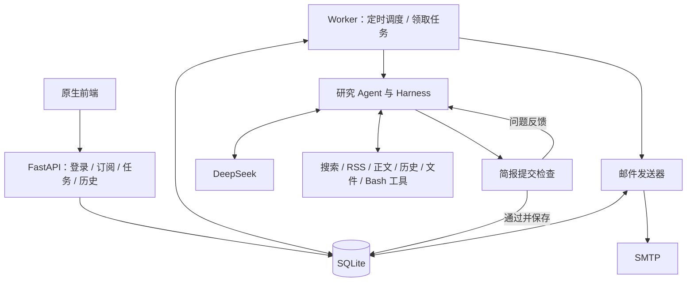

# 每日 AI 新闻助手：实施计划 v1.2

更新日期：2026-10-18。用户已确认选题标准、正文按需读取、证据定位、事件去重和官方 RSS 的实现设计；RSS 默认关闭、可选补充。本次按用户要求，正文支持事实但缺少发布时间等信息时标注后显示；事实仍存疑的候选附后并提供原文链接，继续执行多轮正常使用复验。后续开发以本文、[原始需求.md](原始需求.md) 和 AGENTS.md 为准。默认按第 8.1 节逐步交付；阶段 4 的连续两批授权见该节。

项目核心：一个研究 Agent 根据用户偏好自主搜集、筛选和整理新闻；轻量 harness 管理工具执行、错误反馈、运行记录和交付检查。完成一份最多 5 条的每日简报，是所有设计的判断依据。

## 1. MVP 交付范围

- Python + FastAPI + 原生 HTML/CSS/JavaScript；DeepSeek 模型，手写 Function Calling 循环。
- 博查搜索发现候选并抓取网页正文；官方 RSS 作为可选补充，默认关闭，通过服务端 RSS_ENABLED 启用，无需调用 RSS 即可完成任务。检索中英文来源，统一输出中文；默认覆盖过去 24 小时，最多 5 条。
- 简单注册、登录；每个用户设置昵称、邮箱、话题、关注关键词、排除关键词、订阅开关和推送时间。每人先支持一份订阅，条数可设为 1～5。
- 默认每天北京时间 09:00 触发生成，完成后邮件推送；用户可修改时间。支持立即生成预览、历史简报和任务详情。
- SQLite 保存用户、任务、来源、简报和发送记录；一个 Worker 执行后台任务、定时调度与邮件发送。
- Docker Compose 本地演示，并复用镜像部署到单台 Linux 服务器。密钥与服务参数放在 `.env`，修改后重启生效。

## 2. 技术架构与职责

| 部分 | 实施职责 |
| --- | --- |
| FastAPI | 身份认证、订阅设置、创建预览任务、查询简报和任务时间线 |
| AgentRunner | 构造模型输入，处理工具调用与反馈，驱动循环直到提交通过或停止 |
| 工具执行器 | 注册 schema，检查参数与权限，执行工具，统一返回结果或错误 |
| 存储 | 保存运行消息、任务进度、工具结果、来源材料与简报，支持恢复 |
| 提交检查 | 检查交付规则，并调用模型核对摘要与原文是否一致 |
| Worker | 从数据库领取任务，恢复执行，按订阅时间创建任务，处理邮件发送 |

模型决定查询词、语言、来源、哪些页面值得抓取、需要补查什么、如何选题和何时提交。调度、权限检查、状态保存和邮件发送由应用代码处理。

设计参考：[LangChain](https://docs.langchain.com/oss/python/langchain/agents) 的模型—工具—反馈循环与 harness 职责分工、[LangGraph](https://docs.langchain.com/oss/python/langgraph/persistence) 的运行状态持久化，以及 [Deep Agents](https://docs.langchain.com/oss/python/deepagents/overview) 的材料外置和按需读取。它们分别落实到调用循环、运行记录和正文文件工具，按本项目的每日新闻目标实现。

## 3. Agent 的决策闭环

### 3.1 输入、进度与工具调用

每个 run 保存用户订阅快照和固定新闻窗口。初始模型输入包含偏好、输出要求、工具说明和预算；后续输入追加工具结果与提交检查反馈。

任务进度只保存三个短列表：`已取得材料的话题 / 待补充话题 / 当前问题`。模型通过 `update_progress` 更新；服务端保存变化并展示到任务详情。进度用于提示下一步行动，完成情况仍以实际来源和简报检查结果为准。

通过 DeepSeek Chat Completions 暴露工具 JSON Schema，正常轮次使用 `tool_choice="auto"`，先采用非流式调用。处理步骤如下：

1. 如果有未完成调用，先根据记录恢复；否则将当前消息交给模型。
2. 完整保存模型响应和提出的工具调用，再开始执行。
3. 校验工具名、参数、权限和预算，按响应顺序执行每个调用。
4. 保存结果，并追加对应 `tool_call_id` 的 tool 消息。失败也返回结构化反馈。
5. 模型根据观察继续选择行动；`submit_brief` 通过后保存简报并结束研究任务。

提交通过后，同批次的剩余工具调用返回“任务已结束”，使消息配对完整，并停止执行后续行动。

搜索、抓取、读文件、查询历史和提交的顺序由模型决定。示例：用户关注开源模型和 AI 芯片，首次检索只有模型新闻；Agent 记录芯片材料不足，改用英文查询或限定厂商官网。抓取被阻断时，模型选择其他来源；拿到材料后可以回到筛选和写稿。

模型适配器按[DeepSeek 工具调用规范](https://api-docs.deepseek.com/zh-cn/guides/tool_calls/)保存并重建消息。启用思考模式时，携带 tools 的后续请求按[官方要求](https://api-docs.deepseek.com/zh-cn/guides/thinking_mode/)完整回传历史 `reasoning_content`，包括未实际调用工具的轮次。模型 ID、思考开关和请求参数从配置读取，先用小型连续调用测试确认账号可用性。

正文保存为固定快照，工具返回来源 ID、短摘录、文件路径和章节位置，模型根据目录或关键词定位，再按需分页读取；历史返回当前用户近期已交付事件及关键事实。正文结构和位置索引由代码生成。文件外置减少首次输入的正文，后续读取结果仍计入消息历史；沿用单次工具结果、模型输入和调用预算限制，保持调用与结果消息完整，超过上下文限制时明确停止并保存状态。模型的思考字段仅用于受控存储和协议回传，界面展示行动与结果。

#### 3.1.1 选题标准与话题覆盖

研究提示词明确四项选题依据：与用户话题和关键词的相关性、事件是否有新进展、对用户的实际价值，以及正文证据是否足够。优先考虑已发布或可使用的模型/产品、具体工程实践变化和有明确影响的行业事件；预测、宣传措辞和热度本身不能充当事实依据。模型在预算内自主比较候选、补查缺口并决定入选内容，为每条新闻提供简短入选理由，写入草稿和任务时间线。

代码负责排除词、时间窗口、条数、来源和提交规则检查。每个订阅话题都需要入选条目或未覆盖原因。测试使用相同候选、不同偏好，核对查询或选题及理由的变化；材料不足时允许少于设定条数并说明原因。

### 3.2 简报提交与一次修订

草稿包含中文标题、主新闻条目、未覆盖话题及原因，以及可选的待核实列表。每条主新闻包含标题、摘要、相关话题、事件标识、简短入选理由，以及支持摘要的引用列表。每项引用包含 `source_id / start_offset / end_offset / quote`，位置指向该来源固定正文快照中的字符范围。

`submit_brief` 执行以下检查：

- 代码检查格式、条数、来源归属、引用位置范围、摘录与正文切片一致、排除关键词，并记录重复 URL/正文线索。优先固定24小时窗口，已知超窗来源不列入主新闻；正文有充分事实依据但发布时间缺失、时区/精度不明或时间冲突时可显示，由服务端强制加信息说明，不虚构日期。主新闻继续核对正文哈希与事实，来源链接由服务端生成。
- 规则通过后，用一次独立 DeepSeek 请求核对标题和摘要与所引原文是否一致，重点检查数字、实体、夸大、比较对象和测试条件，同时检查订阅相关性、未覆盖话题说明和事件重复。输入包含用户要求、草稿、服务端从固定正文取出的引用及相邻上下文，以及与本次候选相关的近期已交付事件。引用上下文保留单位、适用条件、限制和必要表格信息；超出核对输入边界时返回具体问题。输出问题条目与解释。
- 问题作为工具结果返回主 Agent，它决定补搜、重读原文、修改或替换新闻。允许一次修订后重新检查；规则失败同样计入提交修订次数。第二次提交取得有效的独立事实核对拒绝结果时，仅交付明确标注的待核实原文线索；规则、权限、引用损坏、核对输入不完整或服务/协议故障仍保存错误并停止。
- 核对请求沿用有限网络重试；调用失败不算检查通过。模型核对结果需要通过人工样例验证。

在预算内尽量补齐设定条数，事实依据不足、数字冲突等可能影响真实性时继续搜索或换来源。仍不能确认的候选进入 unverified_items，模型只提供本任务 candidate_id 和具体原因，服务端补原文标题和链接；页面与邮件在末尾单列“待核实信息”，不计入主新闻条数、不写入已交付事实历史。只缺发布时间等信息的主新闻会自动标注，无需仅为补时间而丢弃。只有待核实候选时也可保存交付，明确尚无可确认的主新闻；既无主新闻也无待核实候选的空简报仍需有效检索，不将依赖故障冒充无新闻。

提交核对提出问题时，反馈对应条目的原始候选编号；模型按全部反馈修正，无法在剩余预算内补查的争议条目移入待核实列表并说明原因。常用机构简称和不改变事实的等义复述可接受。继续保留两次提交上限、主新闻准确引用与独立事实核对。

2026-10-18 用户审核通过最终交付调整：最后一次有效事实核对仍有争议时，服务端从已验证归属的来源生成原文标题、核对问题与链接，标记 review_status=unverified；整份稿件不发布为主新闻，不复制被拒绝摘要或关键事实，不计主新闻数、不写已确认事实历史。确定性历史事实重复也可保留线索，并明确指出重复问题。最多保留5个去重原文候选，页面和邮件明确说明。原始草稿、来源哈希、拒绝结果及待核实文档作为固定提交意图保存；恢复复用同一结果、同一链接和同一发送记录，不增加模型调用或第三次提交。

关注话题和关键词影响查询、筛选与选题；排除关键词在候选筛选和提交时检查。每个订阅话题要有入选条目或简短说明，例如没有有效新闻、证据不足或条数限制下的选题取舍，不能默默遗漏。模型核对还要检查正文以中文表达；产品、模型和机构名称可保留原文。

提交通过后，预览模式完成内容保存；定时模式在同一数据库事务中保存简报、生成邮件发送记录并标记研究完成。模型提出提交，应用负责保证交付条件和入队一致性。

## 4. 工具与联网搜索

工具统一返回 `ok / data / error`；大内容增加文件引用。错误至少包含错误码、简短原因和是否可重试。工具的 user_id、run_id、收件人与工作目录由服务端绑定。

| 工具 | 用途与边界 |
| --- | --- |
| `list_dir(path)` | 列出当前任务目录中的材料和笔记 |
| `read_file(path, offset, limit)` | 按字符位置分页读取正文与笔记，返回实际范围、next_offset、eof 和截断状态 |
| `search_content(keyword, dir, cursor?, limit)` | 按字面关键词定位当前任务材料，返回文件、匹配位置、附近摘录和下一页游标 |
| `write_file(path, content)` | 原子写入任务笔记和草稿，限制在 scratch 目录 |
| `bash(command)` | 在 Docker 隔离环境执行受限只读命令，检查材料数量等 |
| `web_search(query, language, domains, limit)` | 调用博查，返回标题、URL、摘要、日期线索和 candidate_id |
| `read_feed(feed_id, limit)` | 读取服务端配置的官方 RSS/Atom 来源，生成与搜索一致的候选，保留来源及原始日期线索 |
| `fetch_url(candidate_id)` | 抓取已发现页面，保存固定正文与位置索引，返回来源 ID、导航、短摘录和文件引用 |
| `query_history(days, limit)` | 查询当前用户近期已交付事件、关键事实和交付时间，支持重复判断及新进展比较 |
| `update_progress(collected, missing, issues)` | 更新简短任务进度 |
| `submit_brief(draft)` | 检查并提交简报，返回成功或具体问题 |

五个指定基础工具是最低交付要求，分别实现和测试，任务可按需要使用。实施时可在现有项目目标、配置和权限边界内按需要随时增加工具；新增工具说明用途，提供参数 schema，沿用参数与权限校验、结果大小和预算边界、统一反馈、调用记录和恢复机制，并编写相关测试。模型写入草稿文件后仍需要调用 submit_brief；文件内容不直接改变交付状态。

搜索接入按以下顺序实施：

1. **建立博查适配器。** 使用 httpx 请求 REST API，从 `.env` 获取端点和 key。按[官方开放平台](https://open.bochaai.com/)及用户控制台确认接口，完成一次小请求并保存脱敏响应样本，用于契约测试。
2. **统一候选结构。** 每次默认返回 5 条、最多 10 条，采用 summary=true、freshness=oneDay 粗筛。模型用中英文查询词体现语言，域名条件通过查询条件及返回 URL 校验落实；供应商字段与过滤能力按实测映射。保留原始日期字段，缺失值不补造。
3. **抓取与保存材料。** 下载 HTML，使用 [Trafilatura](https://trafilatura.readthedocs.io/en/latest/) 提取正文及元数据；保存来源 ID、URL、标题、语言、发布时间/时间依据、抓取时间、正文路径和内容哈希。搜索摘要用于发现候选，最终新闻需要能读取并定位的正文依据。
4. **判断时效与去重。** 原文的发布日期与抓取/更新时间分别记录。日期缺失、冲突或精度不足时保留状态并标注显示；已经明确在窗口外的来源只作为补充候选。事实真实性有疑问时再补查来源，仍存疑的附后提供核实链接。规范 URL 与正文哈希辅助去重，模型对同一事件的多篇报道进行合并；历史事件有新进展时注明变化。
5. **反馈质量问题。** 无结果、403、空正文和旧新闻返回明确观察，交给模型改词、换来源或换选题；临时网络故障由工具执行器有限重试。

网页请求限制耗时、下载大小与重定向次数，只允许公开 http(s) 地址。每次跳转验证目标及实际连接地址，阻止内网访问。网页内容作为材料使用，不能改变订阅、权限或收件人。

### 4.1 正文快照与位置索引

`fetch_url` 经公网请求校验和正文提取后，将完整正文按统一 UTF-8 编码与换行规则保存到 `data/runs/<run_id>/sources/<source_id>/body.txt`。保留标题、自然段、列表和必要表格内容；来源记录保存最终 URL、标题、语言、时间依据、抓取时间、正文路径、提取版本和内容哈希。索引记录章节标题及各段的字符起止位置；缺少章节标题时按自然段建立索引。

位置采用解码后正文字符串的零起点 Unicode 字符偏移，区间为 `[start_offset, end_offset)`，与字节位置区分。一次生成的正文与索引保持一致，后续读取与引用均针对这一份快照。网页再次抓取且内容变化时创建新的来源快照，保留已有引用。模型的文件写入只允许修改 scratch；来源快照由可信抓取工具保存。

抓取先完成临时文件与原子落盘，再在短事务中保存来源、索引和调用结果。中断后按调用记录、文件哈希和已保存索引核对：复用一致的快照，处理尚未完成登记的文件；缺失或不一致时返回材料状态问题。恢复始终保持同一个 run 的新闻窗口和引用版本。

抓取结果返回 `source_id / title / file_path / char_count / content_hash / preview / sections`，其中 sections 只包含标题和位置，preview 为有大小限制的开头原文摘录。导航和摘录受工具结果大小限制，展示部分章节时说明省略数量，完整索引仍随来源保存。导航由代码生成，模型可以据此直接读章节，也可以搜索关键词；具体读取顺序与次数由模型决定。

### 4.2 关键词定位与分页读取

`read_file` 的 path 为当前任务相对路径，offset 为大于等于零的字符位置，limit 为正整数；初始默认 3,000、最多 6,000 字符，实际返回同时受 `max_tool_result_chars` 限制。结果包含 path、正文 content、实际 start_offset/end_offset、next_offset、eof 和 truncated。完整到达文件结尾时 eof 为真；因页长或结果大小限制尚有内容时提供下一位置。UTF-8 解码后再切片，保证中文和其他多字节字符分页可读。

`search_content` 的 keyword 为非空字面字符串，dir 为当前任务相对目录；limit 初始默认 10、最多 20 条。返回每个命中的相对文件路径、字符起止位置和附近短摘录；结果超过页长或大小限制时提供 next_cursor。游标由服务端生成并绑定当前 run、目录、关键词和材料版本，参数或材料变化时返回明确反馈。笔记可修改，分页读取与搜索时校验文件版本，避免把旧位置用于新内容。

所有目录、文件和游标按当前 user_id/run_id 校验；拒绝目录越界、符号链接逃逸、非法位置、无效编码和伪造游标。参数错误与材料问题沿用统一 `ok / data / error`、错误码和可重试标志。搜索结果和正文片段保留来源关系，返回合法完整结构，并记录调用、范围和结果引用。

关键词未命中表示该字面字符串没有出现。研究提示词要求模型结合材料语言换词、查看章节或扩大读取范围；核实事实时读取邻近说明，不能仅依据短命中片段写摘要。相关测试覆盖跨页数字/条件、中英文换词、空文件和末页、长段落与表格、结果大小限制及越权。验证定位与全文阅读是否一致，并记录定位所耗工具次数。

### 4.3 事件合并与近期历史

规范 URL 和正文哈希用于识别同一页面或相同材料。同 URL 的不同正文版本仍需比较新增事实及时间依据，重复材料线索不能直接代替事件判断。模型结合机构、产品/版本、发生的事情、事件日期和关键事实合并同一事件的多篇报道，选择信息完整的来源并保留支持摘要的引用。事件标识作为关联线索；重复判断同时比较事实，不能单凭模型给出的标识决定。

`query_history` 只返回当前用户近期已交付事件及关键事实、新闻标题、来源引用和交付时间，结果受 days、limit 及工具大小限制。模型将候选与历史比较：事实相同则避免重复选题；有实质进展时可入选，摘要说明新增变化。提交规则检查重复材料线索，独立模型核对结合相关历史检查同一事件的不同报道和新进展，沿用一次修订流程。

测试包含同一事件多媒体报道、不同模型版本、不同事件使用相似标题、昨天已交付今天没有变化、旧事件今天有新进展，以及不同用户的历史隔离。

### 4.4 官方 RSS 候选工具

官方 RSS 指发布机构自己提供的 RSS/Atom 文章更新清单。先配置少量经实际请求确认可用的模型厂商、芯片厂商或开源社区来源。配置使用服务端本地来源文件，路径由 `.env` 中的 `RSS_SOURCES_FILE` 指定；条目包含稳定 feed_id、名称、公开订阅地址和 enabled。修改后重启生效；配置样例只提供占位条目，实际来源地址及可用性在 2.5 验证。

`read_feed(feed_id, limit)` 的 feed_id 只能选择已启用的服务端配置，limit 初始默认 5、范围 1～10。初始模型输入包含可用来源的 ID 和名称，工具参数不接受任意订阅地址。返回与 web_search 一致的 candidate_id、标题、文章 URL、摘要和原始日期字段，并保留 discovery_method/feed_id；重复链接和再次执行同一调用时复用已有候选登记。模型自主选择是否读取 RSS、读取哪个来源，以及是否继续搜索或抓取。

RSS 请求沿用公开 http(s)、实际连接地址、每次重定向、耗时和下载大小校验；解析禁用 XML 外部实体及解析器发起的额外网络请求。文章链接在登记和抓取时校验。缺失或含糊的日期保持原始状态，feed 更新时间与文章发布时间分别记录；摘要和日期线索进入统一正文抓取与提交检查链路。

工具注册 JSON Schema，未知/禁用 feed_id、无效 limit、解析失败、旧条目和空清单返回结构化反馈；429、5xx 和临时超时沿用安全读请求的有限重试和 waiting_retry。每次逻辑 RSS 读取扣一次 searches 和 tool_calls，重试保留同一逻辑调用，外部尝试照常记录。搜索与 RSS 共用候选发现预算，单次 RSS 下载不另扣正文 fetches。单个来源失败时模型可使用其他有效来源；依赖故障与有效读取后确无新闻分别记录。

离线测试覆盖 RSS/Atom 解析、候选结构、链接重复、日期缺失/时区/更新日期、空或旧清单、feed_id/参数权限、公网请求与 XML 边界、结果大小、限流重试、预算与恢复。真实验收记录实际来源地址、请求日期、解析结果和未通过原因，后续接入正文与引用轨迹。

### 4.5 材料检索扩展评估

当前材料检索通过正文结构索引、字面关键词和按字符分页读取实现。真实验收统计相关信息漏检、工具次数、输入 token 与耗时。后续跨较长历史或大量材料查询时，先评估全文搜索；若同义表达或跨语言定位持续影响质量，再评估按段落组合文本块、生成 embedding 并进行语义检索。任何扩展继续保留 source_id、正文版本和位置，使检索结果可回到原文核对；技术与范围变更按用户审核流程确认后纳入实施。

## 5. Harness、失败处理与恢复

run 状态使用 `queued / running / waiting_retry / completed / no_news / failed`。保存消息历史、任务进度、工具调用与结果、已抓取材料、预算消耗和停止原因。一个 Worker 同时只研究一个 run，内部调度、心跳和发送检查使用独立异步任务，持续响应；数据库事务保持短小，网络请求在事务外执行。

初始预算：最多 15 次主模型请求、8 次逻辑候选发现（web_search 与 read_feed 共用 searches）、12 次逻辑正文抓取、50 次工具调用；首次开始执行后 10 分钟截止。一次外部请求最多尝试 3 次，模型重试也计入模型请求数。预算可配置，尝试开始前保存计数，恢复不重置预算和截止时间。接近限额时提示模型完成提交，预留一次决策与提交检查的机会。

| 情况 | 处理方式 |
| --- | --- |
| 参数错误、无结果、正文不可用、简报不合格 | 返回具体问题，模型决定下一步行动 |
| 429、5xx、临时超时 | 有限退避，尊重 Retry-After；长等待保存 waiting_retry，Worker 处理其他任务 |
| 鉴权、余额或配置错误 | 停止无效重试，记录依赖和原因 |
| 供应商请求协议或 schema 错误 | 保存错误响应的脱敏摘要，检查消息配对、思考字段与工具定义；停止无效重试 |
| 超过预算/截止时间、重复无效行动 | 明确停止；同一失败动作连续重复 3 次先提醒，再次重复就结束 |
| 模型普通文本结束但尚未提交 | 提示一次缺少提交；仍不提交就记录协议错误 |
| 重启时有未完成的调用 | 完成结果已保存则复用；安全读操作可重试；文件写入比较目标内容哈希后完成或报告冲突 |

工具调用用 `(run_id, tool_call_id)` 唯一标识，保存 pending、executing 和最终结果。模型响应及调用列表落库后才执行；工具结果、对应消息和业务状态在事务中协调保存。文件写入前记录原内容与目标内容的哈希，再原子替换，恢复时据此判断是否已经完成。同参数的新调用可以是有意重查，与恢复旧调用分别处理。

数据库在事务中领取任务并记录领取标识和心跳，只有当前领取者可以更新任务；启动时仅接管已失去执行者的任务，恢复前终止该任务残留的 Bash 进程/容器。当前任务目录和来源归属始终由应用检查。Bash 只开放明确安全参数的 ls、wc、head、tail、sort、uniq、rg，拒绝管道、重定向、命令替换及任意程序启动；因此中断的允许命令可以重试。

邮件发送记录以 brief_id 唯一入队，保存固定收件人、正文和状态：pending、sending、sent、failed、unknown。明确未被 SMTP 接受的临时失败可以重试；发送中断且无法判断是否被接受时标记 unknown，等待人工核实后显式重发。SMTP 接受代表服务商接收，不保证最终送达。

## 6. Trace 与错误定位

每个任务使用稳定 run_id，数据库事件加结构化日志形成时间线。记录每次模型请求、工具调用、进度更新、提交问题、重试、恢复和邮件结果；包含时间、调用 ID、参数摘要、结果/来源引用、耗时、错误码、供应商请求 ID（若提供）及 token 用量。

任务详情展示“查了什么、得到什么、补查了哪个话题、稿件哪里有问题、最终为何结束”。行动原因以模型提供的简短说明或已保存反馈为准，缺失时标记缺失。完整协议与正文存储在受控位置，日志过滤密钥、密码、Cookie 等内容。

定位步骤：从 run_id 查看最后状态和失败事件，再查对应工具记录、供应商请求标识和当时材料。例如能区分“博查请求失败”“正文没抓到”“日期无法确认”“模型摘要不受来源支持”。恢复读取持久状态和工具记录。

## 7. 页面、调度与配置部署

### 7.1 2026-10-20 已批准的前端改版

用户已批准完整实施以简报阅读为中心的前端改版，并授权本轮连续完成五步。采用暖白、深灰、墨绿的简约电子报风格，桌面与移动端优先阅读；保留原生HTML/CSS/JavaScript和现有API。主要入口为今日简报、历史简报、订阅设置，账户菜单提供资料与退出。首页展示实际生成日期和最近简报，非当日内容明确标注。新闻显示标题、摘要、来源与必要时间说明，引用依据可展开，待核实信息独立展示。

生成预览和重新生成使用现有任务接口，生成期间保留原内容，只展示必要状态；新结果提示用户主动打开。每次生成保留独立历史，预览不发邮件；重新生成采用当前偏好和当前时间窗口。前端负责导航、阅读、表单、接口消费和异步状态；Agent决策、核对、去重、权限、恢复、调度、邮件及持久化继续由后端负责。运行记录保留供排查验收，普通页面不展示任务列表、工具时间线和预算，也不读取详细事件接口。

按五个小步骤交付：①页面框架、视觉与登录；②简报阅读、来源与必要说明；③生成、重新生成和异步状态；④历史分页/详情导航与订阅账户设置；⑤响应式、无障碍、状态竞态、安全回归及浏览器部署验收。每步完成相关测试、Git commit、GitHub同步和对话review说明；本轮连续推进。前端改动集中在app/static及前端测试，不改变后端业务、数据结构和接口契约。资料、凭据、旧历史和用户现有文件保持既有权限与交付边界。

- **页面与接口：** 注册/登录、订阅设置、立即预览、历史列表/详情、任务详情。最小接口分为 `/auth`、`/me`、`/subscription`、`/runs`、`/briefs`；创建预览立即返回 run_id，页面轮询任务进度。
- **身份与隔离：** 密码使用 Argon2id 哈希，服务端会话使用 HttpOnly/SameSite Cookie，写请求校验 CSRF；按用户校验任务、历史和文件权限，页面转义外部内容。
- **数据库：** 至少包含用户、会话、订阅、任务、工具调用、来源、简报、发送记录和事件。SQLite 使用本地持久卷，开启 WAL 和 busy_timeout；正文存文件，数据库保存索引和哈希。
- **调度：** 存储 UTC，按 Asia/Shanghai 计算 HH:mm。日常任务按用户、订阅和北京时间业务日期去重。新闻窗口固定为计划触发时刻之前 24 小时，预览使用创建时刻；恢复保持窗口不变。
- **修改与暂停：** 修改推送时间重算下次任务，当日已创建任务保持唯一；正在执行的任务使用订阅快照，暂停后阻止新任务，并在邮件入队/发送前检查订阅开关。停机后默认允许 2 小时内补跑，超过则记录错过并安排下一次。
- **配置：** 独立 Settings 读取 `.env` 中的 DeepSeek、博查、SMTP、会话密钥、数据路径、超时、预算和 RSS_SOURCES_FILE。RSS 来源文件由服务端读取和校验，示例与运行配置分别管理。`.env` 和运行数据不进入 Git，`.env.example` 仅有占位值；配置改变后重启服务。凭据不进入模型输入、工具结果或 Bash 环境。
- **Docker：** API 和 Worker 使用相同应用镜像；Bash 工具在受限容器运行，只映射当前任务目录，输入/来源只读，笔记由文件工具写入。容器无凭据、无 Docker socket、禁用网络、使用非 root 并限制资源；可信 Worker 通过固定参数管理工具容器。
- **操作交付：** 提供 `docs/deployment.md`，说明填写 `.env`、初始化数据库和 `docker compose up -d --build`；配健康检查、Worker 心跳和自动重启。服务器增加 HTTPS、Secure Cookie、一致性数据库/文件备份及恢复步骤。

## 8. 开发顺序与验收

| 阶段 | 交付 | 完成标准 |
| --- | --- | --- |
| 1：执行骨架 | 配置、SQLite、运行状态、工具协议、手写循环和替身工具 | 工具成功/失败都能正确反馈；预算与调用记录可保存 |
| 2：研究 Agent | DeepSeek、博查、官方 RSS、正文快照和索引、历史、任务进度、五个基础工具 | 能生成真实候选与正文；模型按偏好选题，遇到零结果、抓取失败、定位未命中或话题缺失会调整行动 |
| 3：质量与恢复 | 简报提交检查、证据位置与上下文、事件重复核对、一次修订、重启恢复、时间线 | 能修正无依据或遗漏条件的摘要；恢复同一个 run，复用相同正文快照并保持窗口和预算 |
| 4：产品链路 | 登录、订阅、预览、历史、调度和 SMTP | 本地测试邮箱链路通过，改时间/暂停/重复触发正确 |
| 5：部署与演示 | Docker、部署说明、核心场景测试和示例轨迹 | 按文档可启动；核心验收用例通过；记录真实服务测试结果及限制 |

目录按职责组织：`app/api/`、`app/agent/`、`app/tools/`、`app/providers/`、`app/storage/`、`app/worker/`、`app/static/`，加 `tests/`、`docs/` 与 Git 忽略的 `data/`。函数和接口用 Pydantic 校验输入，提示词随代码版本管理。

每阶段编写相关 pytest 测试，通过后 Git commit 并同步 GitHub，附一句话说明本次修改的位置与内容。日常测试使用固定新闻和模型/HTTP 替身、本地 SMTP 测试服务；真实模型决策测试与 DeepSeek/博查/指定测试邮箱的联通结果单独记录。

每次编码后提供详细 review 说明：本次完成内容与目的、逐文件职责和改动、关键行为与配置/权限/恢复逻辑、测试命令与结果、未完成项和限制，以及 commit 标识与 GitHub 同步结果。新增工具说明其用途和边界，具体报告要求见《原始需求.md》第 2.2 节。

### 8.1 小步骤与 review 节奏

2026-10-15 用户授权连续推进阶段 5 直到项目交付，各小步骤继续执行自动化验证、Git commit 与 GitHub 同步，并在对话中说明改动；统一人工测试由用户在完成后进行。缺失服务参数或未通过的真实验收保留明确记录，完成其余可实施工作。5.1 的 Compose 使用 API/Worker 共享命名卷与工具当前任务子目录只读挂载；当前 Windows 中文路径构建兼容由临时 ASCII 白名单上下文脚本处理，运行配置与用户数据不进入镜像。

5.2 的常规运维细节：管理员停写后通过 app.ops 同包保存数据库、正文/索引及来源/文件恢复意图，校验哈希和数据库完整性后恢复到空卷；保留旧数据用于回退。HTTPS 使用主机反向代理与独立 Compose 覆盖文件，明确配置可信代理 IP 和 Secure Cookie。公网域名、证书与服务器验收需要实际部署环境；恢复旧备份后先关闭邮件并核对外部发送副作用，再启用。

5.4 实测反馈修复：同一 event_id、明确版本及完整关键事实集合均相同的近期已交付事件，由代码返回重复问题；不同事实、版本或不明确身份仍交给独立模型核对。此检查沿用第 3.2 节事件事实与提交反馈目标，不新增工具或外部权限。当前网络 Fake-IP 返回保留地址时继续拒绝网页连接；真实完整研究与五份简报人工审阅保留待验收。

2026-10-15 用户授权本轮连续完成阶段 4 的剩余工作，并允许实施中直接调整计划、告知并更新文稿。本轮分两批交付：第一批完成 4.3 页面与 4.4 调度，第二批完成 4.5 邮件与阶段 4 验收；每批完成相关测试、Git commit 和 GitHub 同步，本轮批次之间连续推进。原小步骤编号保留，便于对应验收；阶段 4 范围内的计划调整记录依据、行为和验收影响。此授权不改变 README、配置凭据、用户数据和外部服务验收边界。

本轮补充实施细节：新建订阅、改推送时间或恢复订阅时，从不早于保存时刻的下一个北京时间时刻开始；既有计划在服务停机后才适用两小时补跑，普通偏好修改保留原计划。长时间停机的连续旧日期压缩为错过区间记录，并单独判断最近计划是否能补跑。邮件增加 SMTP_ENABLED 显式开关，默认关闭；指定测试收件人时作为允许名单校验，不改写已固定收件人。发送结果 unknown 只允许用户明确确认重复风险后重发。以上细节分别按调度边界、真实本地测试 SMTP、状态恢复和页面确认验收。

4.5 实施补充：一次自动发送周期最多三次尝试，明确未接受的临时失败持久保存下次时间；永久拒绝与不确定结果停止自动发送。发送前记录领取令牌、到期时间与尝试流水，到期仍为 sending 的记录转 unknown。手动重发复用原固定收件人、正文和 Message-ID，开启新的有限尝试周期；Message-ID 只辅助识别，不能保证服务商去重。页面采用带风险说明及确认/取消按钮的确认区，便于查看和测试，服务端仍要求 unknown 的显式确认参数。SMTP 明文模式只允许无认证的回环测试服务，实际服务器使用校验证书的 STARTTLS 或 SSL；SMTP 接受只表示接收，不代表最终送达。阶段 4 用真实本地 TCP SMTP、进程中断与页面闭环验收；真实服务参数未齐备的联通继续列为待完成。

用户已于 2026-10-10 授权细化步骤，并于 2026-10-12 确认本次研究设计与官方 RSS 扩展。实施保留五个阶段；阶段 2 将官方 RSS 单列为 2.5，偏好与研究验收为 2.6，共六个小步骤，其余阶段各五步。每次只推进一个小步骤，完成相关测试、Git commit、GitHub 同步和详细说明后停下来，等待用户确认。每次额外提供一段简短 review，解释代码入口、主要流程与关键边界，帮助用户快速理解改动。每阶段最后一个步骤同时核对本阶段验收。

| 步骤 | 本步交付 | 重点验证 |
| --- | --- | --- |
| 1.1 项目骨架与配置 | Python 包与依赖、Settings、占位配置、Git 忽略规则、最小健康接口和开发说明 | 无真实凭据可启动；配置覆盖与非法值校验；敏感值不出现在响应和配置展示中 |
| 1.2 SQLite 与运行状态 | 数据库初始化、运行与事件记录、订阅快照、固定新闻窗口、状态流转与预算持久化 | WAL/busy_timeout、事务回滚、重新打开后窗口与计数不变 |
| 1.3 工具执行协议 | 工具注册与 schema、统一结果、服务端上下文、参数/权限/大小校验、调用记录与替身工具 | 成功和失败记录、未知工具、参数错误、任务与用户归属 |
| 1.4 模型调用循环 | 模型协议与替身、响应先保存、按序执行、配对反馈、多轮决策与停止规则 | 模型根据反馈改变行动；普通文本未提交提示；提交后的调用完整配对 |
| 1.5 骨架验收与预算 | 联通替身运行、预算与截止时间、有限重试与 waiting_retry、失败重复提醒和停止 | 调用前计数、限流、重试预算、上下文限制与阶段 1 端到端轨迹 |
| 2.1 DeepSeek 适配器 | Chat Completions、auto 工具调用、配置参数、完整协议与 reasoning_content 回传 | 连续调用契约、无工具轮次历史、鉴权/协议错误；参数齐备时真实小请求 |
| 2.2 博查搜索 | HTTP 适配器、统一候选、语言/域名条件、日期线索与脱敏样本 | 有效结果/零结果、粗筛与字段缺失、限流；参数齐备时真实搜索 |
| 2.3 正文抓取与来源 | 公网地址及连接校验、Trafilatura 提取、固定正文快照、章节/段落字符索引、时间依据与去重 | SSRF、403/空正文、下载限制、日期缺失/冲突、索引与正文一致、原子落盘及材料状态问题 |
| 2.4 五个基础工具 | list_dir/read_file/search_content/write_file、按字符分页、搜索游标、原子笔记写入、Docker 隔离 Bash | 五工具分别测试、中文/末页/跨页条件、匹配位置读回、版本变化、目录越界、大小限制与容器权限 |
| 2.5 官方 RSS | read_feed、来源配置、RSS/Atom 解析、统一候选、共用发现预算及真实来源探测 | 日期和链接、空/旧清单、配置/权限/XML/SSRF 边界、限流/恢复；实际来源可用性记录 |
| 2.6 偏好与研究验收 | query_history/update_progress、选题依据与理由、事件合并/新进展、按导航和关键词读正文、反馈补查 | 偏好差异、排除词、搜索/RSS 候选一致、定位未命中换词、事件合并、话题缺口、网页诱导与阶段 2 轨迹 |
| 3.1 提交规则 | 草稿与引用 schema、条数/归属/窗口/位置/摘录/哈希/排除词/重复材料检查 | 伪造引用与位置、正文缺失/变化、合法及不合法草稿、少量新闻说明、空简报与依赖失败区分 |
| 3.2 模型核对与修订 | 服务端取引用及相邻上下文、相关历史、独立核对、一次修订、中文与事件重复检查 | 无依据数字、遗漏测试条件、断章取义、同事件重复/新增事实、两次提交上限与核对服务失败；人工样例核对 |
| 3.3 Worker 与恢复 | 任务领取、领取者校验、心跳、失去执行者接管、pending/executing 调用和来源登记恢复 | 响应后/工具中重启、复用相同快照与引用位置、文件/索引一致、原子写入冲突、残留 Bash 清理 |
| 3.4 交付事务与时间线 | 简报提交事务、发送记录预留、事件查询、结构化日志与脱敏 | 入队唯一、事务中断、调用/反馈/恢复可追溯、敏感协议受控保存 |
| 3.5 质量与恢复验收 | 修订/恢复演示轨迹、停止原因与回归测试、真实模型核对记录 | 同一 run 恢复且窗口/预算不变，提交和入队不重复，阶段 3 验收 |
| 4.1 身份与会话 | 用户/会话存储、注册登录退出、Argon2id、Cookie 与 CSRF | 密码哈希、会话失效、CSRF、用户越权与敏感值隔离 |
| 4.2 订阅与预览接口 | /me、/subscription、/runs、/briefs、订阅设置、预览与历史 | 输入校验、run 快速返回、订阅快照、任务/简报归属与历史查询 |
| 4.3 最小页面 | 注册登录、偏好表单、预览轮询、历史与任务时间线 | 完整页面流程、错误反馈、外部内容转义与状态展示 |
| 4.4 定时调度 | UTC 存储、北京时间 HH:mm、业务日期去重、改时间/暂停/补跑 | 09:00 默认、重复触发、改时间、暂停、2 小时补跑边界与窗口固定 |
| 4.5 邮件与产品验收 | SMTP 发送器、本地测试邮箱、发送状态、暂停再检查和显式重发 | 入队/发送去重、接受后中断 unknown、临时失败重试、产品端到端验收 |
| 5.1 Compose 与镜像 | API/Worker 共用镜像、独立 Bash 工具镜像、持久卷、健康与自动重启 | 本地构建启动、配置注入、非 root、网络/资源/挂载限制 |
| 5.2 部署与运维说明 | docs/deployment.md、Linux/HTTPS/Secure Cookie、数据库与材料一致性备份恢复 | 按文档部署、Worker 心跳检查与备份恢复演练 |
| 5.3 核心验收回归 | 核心与安全测试汇总、登录到定时邮件端到端、反馈/修订/恢复演示 | 核心八项验收、失败原因展示、对应回归用例与稳定轨迹 |
| 5.4 真实服务验收 | DeepSeek/博查/官方 RSS/指定测试邮箱联通、真实研究与定位统计、简报人工核对 | 真实关键行为至少 3 次，人工核对至少 5 份，记录定位漏检/调用/token/耗时；未联通项保持待验收 |
| 5.5 最终交付检查 | 交付清单、示例轨迹与已知限制、最终部署复验 | 测试与真实验收记录一致、密钥/运行数据不入 Git、提交同步完整 |

各步的测试结果和未完成联通验收记录在 `docs/` 中。缺少服务参数时使用替身完成可验证部分，阶段报告明确区分离线通过与真实待验收。数据库、工具容器和发送记录在对应步骤逐步引入；第 5 阶段整合部署和验收。

核心验收包括：

1. 正常任务在预算内尽量生成设定条数、最多5条中文主新闻；引用与固定正文一致，保留事实条件。日期已确认的处于固定窗口；缺少时间信息的明确标注。事实存疑候选单独附后说明原因和原文链接，不计主新闻条数。
2. 相同订阅分别遇到有效结果和零结果，模型对零结果采取合适补查或有依据地说明不足；抓取成功/失败也测试一组成对场景。搜索与 RSS 形成统一候选，验证日期、链接、限流和恢复；正文关键词未命中后会换词、读章节或补查。
3. 某话题缺少材料时，任务进度体现缺口，后续行动针对该缺口。
4. 给草稿加入原文没有的数字或省略适用条件，检查能指出问题，Agent 修订或换题后重新提交；核对同事件多报道合并、历史无变化避免重复、有新进展说明变化。
5. 模型响应保存后、工具执行中和邮件入队后模拟重启，验证恢复和去重；正文快照、索引、引用位置与窗口/预算一致，SMTP 接受后中断得到 unknown。
6. 密钥隔离、目录越界、用户越权、网页诱导、限流和预算用例通过。
7. 登录到预览、历史、定时邮件的端到端测试通过；真实模型运行关键行为场景至少 3 次，记录成功情况、调用次数、token 和耗时，并人工核对至少 5 份简报。
8. 偏好验收：相同新闻材料使用不同订阅，查询或选题及入选理由体现偏好变化；命中排除词的新闻被过滤，未覆盖话题有说明，中英文材料生成的简报以中文表达。统计按需读取与全文核对的定位一致性、漏检、调用次数、token 和耗时。

演示至少包含一条反馈驱动补查、一条摘要修订和一条中断恢复轨迹。对失败明确展示原因，并补相应回归用例。

## 9. 开发交接检查

当前交接入口是 `AGENTS.md`、`原始需求.md` 与本文；其他版本作为历史材料。现有 Git 仓库与 GitHub remote 已配置，开发在当前项目目录继续进行。

| 用户要求 | 文档位置与验收依据 |
| --- | --- |
| Python、FastAPI、简单原生页面、登录与身份 | 第 1、2、7 节；端到端验收 |
| 用户按话题/关键词订阅，支持排除词 | 第 1、3.2、7 节；偏好验收 |
| DeepSeek 已有 API，手写循环，自主决定工具顺序、次数与提交 | 第 3.1、5 节；成对反馈场景和停止规则 |
| 至少五个指定基础工具、联网搜索，工具可按需要扩展 | 第 4 节、《原始需求.md》第 2.1 节；分别实现、测试并完成真实搜索联通 |
| 博查和官方 RSS 发现候选、网页原文、中英文来源、中文输出、过去 24 小时、最多 5 条 | 第 1、3.2、4、7 节；统一候选、真实来源、时间、偏好和条数验收 |
| 明确选题标准、正文按需读取、证据位置、事件合并与历史新进展 | 第 3.1.1、3.2、4.1～4.5 节；中文分页、引用/上下文、去重、恢复与定位质量验收 |
| 先邮箱，默认北京时间 09:00，可修改时间 | 第 1、5、7 节；调度、暂停、发送与去重验收 |
| API key 放 .env、与系统解耦、可更改 | 第 7 节；配置替换后重启，无需改业务代码 |
| 本地演示，Docker 可用，方便部署服务器 | 第 7 节；Compose 启动、生产配置与备份说明 |
| 重点展示 Agent、harness、错误恢复与 trace | 第 3、5、6、8 节；补查、修订与恢复轨迹 |
| 技术只采用与任务契合的设计 | 第 2 节的职责与参考原则；以第 8 节交付目标验证 |
| 修改后提交同步，代码有测试，逐文件详细说明，遵守 README 及文本约束 | AGENTS.md、第 8 节、《原始需求.md》第 2.2 节及交接指令 |

真实服务接入需要用户在本地 `.env` 填写 DeepSeek key/可用模型 ID、博查 key/端点和 SMTP host/port/账号/授权码/发件地址，并提供指定测试收件地址；官方 RSS 地址按 4.4 配置和实测确认。开发先交付占位配置与替身链路；缺失参数不妨碍执行骨架和离线测试，但相关真实联通验收保持待完成。已经执行的联通结果以 docs/acceptance.md 为准。

实施以本计划为主。好的改进想法或意料之外的问题涉及计划变更时，先说明依据、建议和影响，请用户审核；认可后再更新计划。既定范围内的常规实现细节可以自行完成。

交给开发对话的指令：

> 先读取 AGENTS.md、《原始需求.md》和《实施计划-v1.2.md》，按五个阶段实现每日 AI 新闻助手。优先完成模型自主工具调用、反馈后行动调整、提交检查和恢复，再补齐页面与邮件。五个指定基础工具是最低交付要求，可在现有目标和权限边界内按需要随时增加工具。遵守配置、权限和交付边界；每次编码后逐文件详细说明修改、目的、关键行为、测试结果和待完成项；每阶段完成相关测试、Git commit 和 GitHub 同步，附一句话修改总结。真实服务参数缺失时先完成替身链路，明确记录待完成的联通验收。以本文验收目标选择常规实现细节；计划变更先提交建议，由用户审核通过后更新。遵守 README.md 和文本内容的协作约束。
